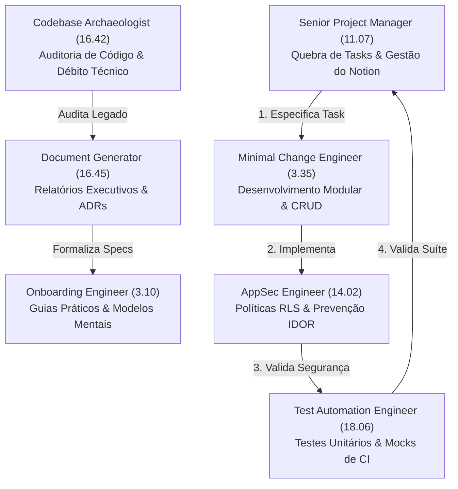
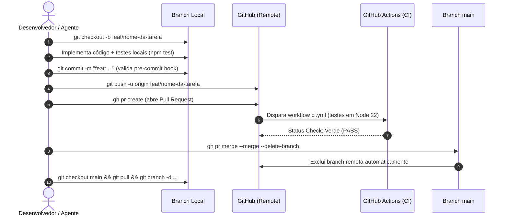
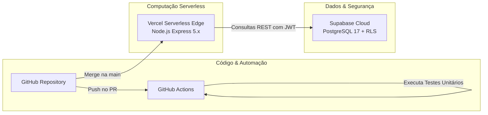

# 📘 Playbook de Governança, Orquestração com Agentes de IA e Workflow CI/CD

> **Classificação:** Blueprint Oficial de Engenharia & Governança de Software  
> **Autores / Squad:** Senior Project Manager (`11.07`), Codebase Archaeologist (`16.42`), Document Generator (`16.45`), Onboarding Engineer (`3.10`), AppSec Engineer (`14.02`)  
> **Finalidade:** Guia metodológico reutilizável para concepção, orquestração de squads autônomas de IA, gestão de tarefas e entrega contínua com custo zero de infraestrutura.  
> **Versão:** 1.0.0  
> **Data:** 11 de Outubro de 2026  

---

## 🧭 1. Visão Geral e Filosofia do Modelo

Este playbook consolida o framework de engenharia e governança adotado no **PersonalController**. Ele foi desenhado para permitir que desenvolvedores e Tech Leads utilizem múltiplos agentes autônomos de IA para construir produtos complexos com:

1. **Zero Alucinação:** Agentes operam apenas sobre especificações e código verificados.
2. **Governança Estrita:** Nenhum agente possui permissão para criar tarefas arbitrárias ou realizar deploys diretos.
3. **Custo Zero de Infraestrutura (Free-Tier Stack):** Backend Serverless na Vercel + PostgreSQL no Supabase + CI/CD no GitHub Actions.
4. **Segurança por Padrão (*Secure by Default*):** Bloqueio de commits de credenciais via hooks, Row Level Security (RLS) mandatório no banco e isolamento total entre tenants.
5. **Git Flow Atômico e Limpo:** Desenvolvimento 100% isolado em branches, Pull Requests revisados e exclusão imediata de branches mescladas.

---

## 🤖 2. Squad de Agentes de IA: Papéis e Orquestração

O desenvolvimento não é feito por um único modelo genérico, mas por uma **squad de agentes com papéis complementares e responsabilidades bem delimitadas** (baseada no framework de Agency Agents):



### Matriz de Responsabilidades da Squad

| Agente / Especialista | Código | Foco Operacional | Entregáveis Principais |
| :--- | :---: | :--- | :--- |
| **Senior Project Manager & Scrum Master** | `11.07` | Converte especificações técnicas em tarefas granulares, controla o board do Notion, limita WIP e garante critérios de aceite. | Backlog estruturado, priorização P0/P1/P2 e governança de cards. |
| **Codebase Archaeologist** | `16.42` | Audita o repositório histórico, identifica código órfão, dependências não utilizadas e desvios arquiteturais (*drifts*). | Relatório de auditoria (`audit-report.md`) e débitos técnicos prioritários. |
| **Document Generator** | `16.45` | Converte a realidade do código em documentação executiva formal para liderança técnica. | Arquitetura oficial (`architecture-status.md`), diagramas C4 e ADRs. |
| **Codebase Onboarding Engineer** | `3.10` | Sintetiza arquitetura e auditoria para criar guias operacionais didáticos para novos desenvolvedores. | Guia de onboarding (`onboarding.md`), setup local determinístico. |
| **Security & AppSec Engineer** | `14.02` | Implementa regras de autorização, integridade de credenciais e proteção contra IDOR. | Políticas de RLS (`CREATE POLICY`), revogação de funções públicas e hooks pré-commit. |
| **Test Automation Engineer** | `18.06` | Cria suítes automatizadas com Jest/Supertest e mocks isolados para garantir CI determinístico e sem dependência de rede externa. | Testes de integração, cobertura de rotas e preflight CORS. |
| **Minimal Change Engineer & Reviewer** | `3.35` / `3.09` | Implementa o código com o menor raio de impacto possível, sem reescrever módulos desnecessariamente. | Código atômico, PRs pequenos e fáceis de revisar. |

---

## 📋 3. Padrão de Gestão de Tarefas (Notion Board)

Todas as atividades do projeto são gerenciadas em um banco de dados relacional no Notion gerido pelo Senior Project Manager.

### Anatomia da Nomenclatura das Tarefas

$$\mathbf{[<Prioridade>] \quad <Identificador> \quad <Separador> \quad <Ação \ e \ Escopo>}$$

#### Exemplos Padronizados:
* `[P0] E01.T01 - Modelar tabela users no PostgreSQL`
* `[P0] E02.T01 - Modelar tabelas categories e transactions`
* `[P0] E02.T02 - Criar endpoints CRUD /transactions e /categories`
* `[P0] SEC-02: Implementar Supabase RLS (Row Level Security)`
* `[P1] E03.T03 - Criar endpoint GET /portfolio/consolidated`
* `[P0] DEP-02: Configurar Projeto e Credenciais da Vercel para CD`

### Elementos da Nomenclatura:

1. **Tag de Prioridade:**
   * `[P0]`: Bloqueador / MVP essencial (schemas, autenticação, deploys core, segurança).
   * `[P1]`: Importante / Próxima iteração (gráficos, cards de KPIs, melhorias de UX).
   * `[P2]`: Baixa prioridade / Débitos secundários / Melhorias incrementais.
2. **Identificador de Módulo:**
   * **Épicos de Produto:** `E{Número_Épico}.T{Número_Tarefa}` (ex: `E01.T01`, `E02.T02`).
   * **Tarefas Transversais:** `<SIGLA>-{Número}` (ex: `SEC-02` para segurança, `DEP-04` para deploy).
3. **Ação Técnica com Verbo no Infinitivo:**
   * Sempre inicia com verbos precisos: *Modelar*, *Criar*, *Implementar*, *Configurar*, *Sincronizar*, *Auditar*.
4. **Metadados Mandatórios do Board:**
   * **Status:** `Não iniciado` $\rightarrow$ `Em andamento` $\rightarrow$ `Em revisão` $\rightarrow$ `Concluído`.
   * **Datas:** `Data Inicio` e `Data Conclusão`.
   * **Atribuir:** Responsável (limite rígido de WIP: máx. 2 tarefas ativas simultâneas por responsável).
   * **Corpo do Card:** Contexto técnico, Critérios de Aceite verificáveis e Dependências explícitas.

---

## 🌿 4. Política Estrita de Git, Branching e Pull Requests

> 🚨 **REGRA DE OURO:** NUNCA commitar ou fazer push direto na branch `main`. A branch `main` reflete exclusivamente o código em produção.

### O Ciclo Completo de Desenvolvimento (Passo a Passo)



### Regras Operacionais de Versionamento:
1. **Criação de Branch:** Sempre derive da `main` atualizada:
   ```bash
   git checkout main && git pull origin main
   git checkout -b <tipo>/<nome-da-tarefa>
   ```
   *Prefixos permitidos:* `feat/`, `fix/`, `docs/`, `chore/`, `test/`, `refactor/`.
2. **Commits Convencionais:** Padrão `@commitlint/config-conventional` (ex: `feat(api): ...`, `fix(ci): ...`, `docs: ...`).
3. **Trava de Segurança Pré-Commit:**
   * O repositório utiliza `.githooks/pre-commit` ativo (`git config core.hooksPath .githooks`).
   * Bloqueia staged files com tokens, secrets, senhas ou arquivos `.env`.
4. **Abertura de PR via CLI:**
   ```bash
   gh pr create --title "tipo(escopo): descrição clara" --body "## Descrição..."
   ```
5. **Automação de CI no PR:** O PR deve aguardar aprovação de todos os checks (`build-and-test`, `squad`, `Vercel Preview`).
6. **Merge e Exclusão Imediata da Branch:**
   ```bash
   gh pr merge <numero> --merge --delete-branch
   git checkout main
   git pull origin main
   git branch -d <tipo>/<nome-da-tarefa>
   ```

---

## ⚙️ 5. Arquitetura de Infraestrutura & Configuração de CI/CD

O stack foi selecionado para garantir **tolerância a falhas, zero custo e deploy contínuo**:



### 1. Camada de Computação (Vercel Serverless)
* **Padrão Serverless com Express 5.x:**
  * O arquivo [`api/index.js`](file:///c:/Users/jvnno/Documents/GitHub/PersonalController/api/index.js) atua como entrypoint exportando o `app` do Express.
  * O [`server.js`](file:///c:/Users/jvnno/Documents/GitHub/PersonalController/server.js) implementa middleware de normalização para lidar com os rewrites da Vercel (`/api/index.js/*`) e monta rotas de forma dual (`/` e `/api`).
  * [`vercel.json`](file:///c:/Users/jvnno/Documents/GitHub/PersonalController/vercel.json) direciona todas as requisições (`/(.*)`) para `/api/index.js`.

### 2. Camada de Dados (Supabase PostgreSQL 17)
* **Migrations Versionadas:** Todo DDL reside em `supabase/migrations/<timestamp>_<nome>.sql`.
* **Row Level Security (RLS) Mandatório:**
  * Toda tabela nasce com `ALTER TABLE ... ENABLE ROW LEVEL SECURITY;`.
  * Policies granulares para `SELECT`, `INSERT`, `UPDATE` e `DELETE` baseadas em `(SELECT auth.uid()) = user_id`.
  * O uso de subselect `(SELECT auth.uid())` é padrão para avaliação em `initPlan` de alta performance.
* **Hardening:** Funções internas do PostgreSQL têm `EXECUTE` revogado de `public`, `anon` e `authenticated`.

### 3. Esteiras de Automação (Workflows do GitHub Actions)

#### A. Workflow de Pull Request (`.github/workflows/ci.yml`)
* **Gatilho:** `pull_request` contra a branch `main`.
* **Ambiente:** `ubuntu-latest`, `node-version: '22'`.
* **Passos:** `checkout` $\rightarrow$ `setup-node` $\rightarrow$ `npm ci` $\rightarrow$ `npm test`.
* **Regra de Testes:** Os testes de integração utilizam **mocks isolados** para chamadas de banco. O CI nunca depende de rede externa ou secrets do Supabase para rodar a suíte de testes unitários.

#### B. Workflow de Deploy em Produção (`.github/workflows/deploy.yml`)
* **Gatilho:** `push` na branch `main`.
* **Jobs:**
  1. `test`: Executa a suíte de testes em Node 22.
  2. `deploy-production`: Com `needs: test`, instala Vercel CLI, puxa variáveis do ambiente `production` e executa `vercel build --prod` + `vercel deploy --prebuilt --prod`.

### 4. Lição Crítica Aprendida: WebSocket no Node Serverless
* **Problema:** O `@supabase/supabase-js` em versões modernas tenta instanciar `RealtimeClient` com WebSocket nativo. Em runners ou ambientes sem suporte nativo, dispara erro `native WebSocket not found`.
* **Solução Padrão:**
  1. Instalar o pacote `ws`.
  2. Configurar explicitamente no cliente:
     ```javascript
     const WebSocket = require('ws');
     createClient(url, key, {
       auth: { persistSession: false, autoRefreshToken: false },
       realtime: { transport: WebSocket }
     });
     ```
  3. Manter a versão do Node padronizada em `22` ou superior em todos os workflows de CI/CD.

---

## 🚀 6. Checklist de Inicialização para Futuros Projetos (Blueprint Reutilizável)

Ao iniciar um novo projeto utilizando esta estratégia, execute esta sequência:

### Fase 0: Setup do Repositório & Segurança
- [ ] Criar repositório no GitHub com `.gitignore` contendo `.env`, `node_modules`, `.vercel`.
- [ ] Configurar o pre-commit hook em `.githooks/pre-commit` e ativar: `git config core.hooksPath .githooks`.
- [ ] Criar `.env.example` completo com placeholders claros.

### Fase 1: Setup da Squad de Agentes
- [ ] Inicializar o diretório `.squad/agents/` com os agentes especialistas (PM, Archaeologist, Documenter, Onboarding, Security, QA).
- [ ] Criar o `.squad/squad-config.yml` definindo limites e responsabilidades.

### Fase 2: Gestão de Backlog no Notion
- [ ] Criar banco de dados de Tasks com colunas: `Task`, `Status`, `Atribuir`, `Data Inicio`, `Data Conclusão`, `Projetos`.
- [ ] Cadastrar as tarefas essenciais com a taxonomia padrão: `[P0] E01.T01`, `[P0] SEC-02`, etc.

### Fase 3: Infraestrutura Cloud (Custo Zero)
- [ ] Criar projeto no Supabase (us-east-1).
- [ ] Conectar projeto na Vercel e gerar token de acesso (`VERCEL_TOKEN`).
- [ ] Configurar Secrets no GitHub Actions (`VERCEL_TOKEN`, `VERCEL_ORG_ID`, `VERCEL_PROJECT_ID`).
- [ ] Adicionar os workflows `.github/workflows/ci.yml` e `deploy.yml` padronizados para Node 22.

### Fase 4: Ciclo de Desenvolvimento (Regra Rígida)
- [ ] **Sempre criar branch:** `git checkout -b <tipo>/<tarefa>`
- [ ] **Desenvolver e testar:** `npm test`
- [ ] **Abrir PR:** `gh pr create`
- [ ] **Validar CI:** Garantir checks verdes
- [ ] **Merge:** `gh pr merge --merge --delete-branch`
- [ ] **Atualizar Notion:** Mover card para `Concluído` com data e commit anexados.

---

*Com este playbook, qualquer novo produto de software pode ser concebido, construído e operado por agentes autônomos com previsibilidade, velocidade e governança de nível corporativo.*
