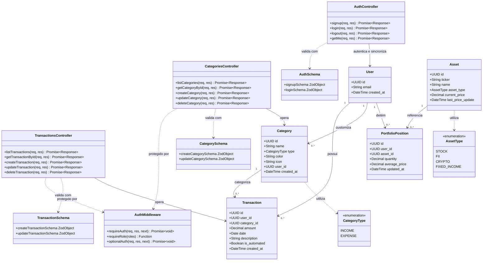
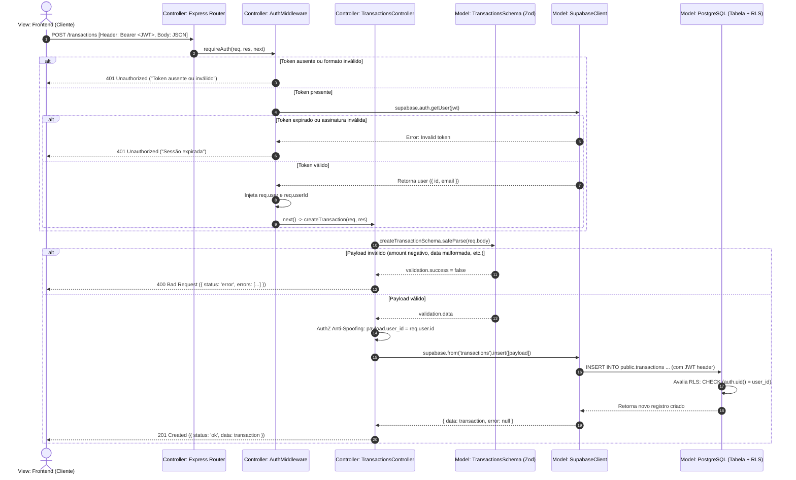
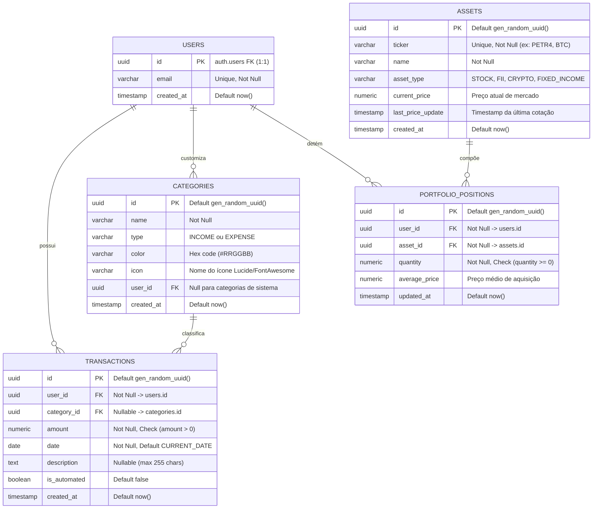
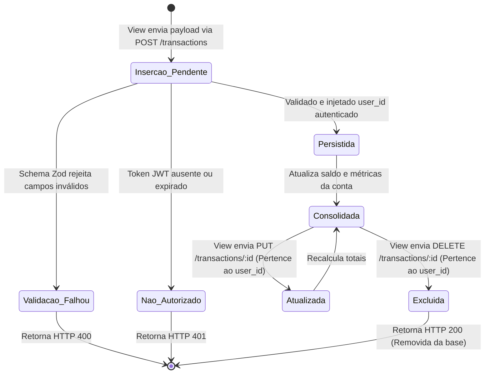

# 📐 Especificação Arquitetural e Diagramas UML (Padrão MVC)

> **Documento:** Especificação Técnica de Engenharia de Software  
> **Sistema:** PersonalController (Gestor Financeiro Pessoal & Consolidação de Portfólio)  
> **Padrão Arquitetural:** Model-View-Controller (MVC) com Backend Serverless e Banco Relacional com RLS  
> **Versão:** 1.0.0  
> **Data:** 13 de Outubro de 2026  

---

## 🏛️ 1. Mapeamento do Padrão MVC no PersonalController

O **PersonalController** implementa a separação de responsabilidades fundamentada no padrão clássico **Model-View-Controller (MVC)**, adaptado para uma arquitetura orientada a APIs REST e Single-Page Application (SPA):

```mermaid
flowchart LR
    subgraph VIEW["🖥️ VIEW (Apresentação & Consumo)"]
        SPA["Frontend SPA (React / Vite)"]
        JSON_RES["JSON Serializer / Response Envelope"]
    end

    subgraph CONTROLLER["⚙️ CONTROLLER (Orquestração & Fluxo)"]
        ROUTES["Express Routers (/routes)"]
        AUTH_MID["Middlewares (requireAuth, requireRole)"]
        CTRL["Express Controllers (/controllers)"]
    end

    subgraph MODEL["📦 MODEL (Domínio, Validação & Persistência)"]
        SCHEMAS["Zod Schemas (/schemas - Validação Estrita)"]
        CLIENT["Supabase Client (/lib/supabase)"]
        DB[(PostgreSQL 17 + Row Level Security)]
    end

    SPA -->|1. Envia Requisição HTTP + JWT| ROUTES
    ROUTES -->|2. Intercepta e Autentica| AUTH_MID
    AUTH_MID -->|3. Encaminha Requisição Válida| CTRL
    CTRL -->|4. Valida Payload de Entrada| SCHEMAS
    CTRL -->|5. Executa Regra de Negócio & Query| CLIENT
    CLIENT -->|6. Aplica Políticas RLS & Persiste| DB
    DB -->>|7. Retorna Dados Filtrados| CLIENT
    CLIENT -->>|8. Entrega Entidade de Domínio| CTRL
    CTRL -->|9. Formata Resposta JSON| JSON_RES
    JSON_RES -->>|10. Renderiza Interface| SPA
```

### Divisão de Responsabilidades:

1. **Model (Domínio e Dados):**
   - **Contratos e Validações:** Localizados em `src/schemas/`, definem a integridade dos dados via Zod (`auth.schema.js`, `transactions.schema.js`, `categories.schema.js`), bloqueando tipos inválidos e *mass assignment*.
   - **Acesso a Dados e Persistência:** Gerenciado via `src/lib/supabase.js` e tabelas no PostgreSQL (`users`, `categories`, `transactions`, `assets`, `portfolio_positions`).
   - **Regras de Isolamento de Dados:** Asseguradas no próprio banco através de *Row Level Security (RLS)* via `auth.uid() = user_id`.

2. **Controller (Controle e Coordenação):**
   - **Roteamento e Filtros de Entrada:** Localizados em `src/routes/`, mapeiam os verbos HTTP (`GET`, `POST`, `PUT`, `DELETE`).
   - **Interceptadores / Middlewares:** `src/middlewares/auth.middleware.js` valida assinaturas de JWT, papéis de acesso (RBAC) e bloqueia requisições sem credenciais.
   - **Lógica de Aplicação:** Localizada em `src/controllers/`, orquestra a validação dos Schemas do Model, injeta o identificador do usuário autenticado (`req.user.id`) para prevenir spoofing (AuthZ) e despacha o status HTTP correto (200, 201, 400, 401, 403, 404, 500).

3. **View (Apresentação e Formatação):**
   - **Frontend SPA (Cliente):** Interface interativa em React/Tailwind responsável por interagir com o usuário e disparar requisições.
   - **Envelopes de Resposta REST:** Padronização estruturada de respostas JSON (`{ status: 'ok', data: ..., count: ... }` ou `{ status: 'error', message: ..., errors: [...] }`), garantindo previsibilidade para a camada cliente.

---

## 📊 2. Diagrama de Classes UML (Camadas Controller e Model)

O diagrama a seguir especifica as classes e módulos principais do backend, demonstrando atributos, métodos públicos e relacionamentos de dependência e agregação:



---

## 🔄 3. Diagrama de Sequência UML (Fluxo MVC da Requisição)

O diagrama de sequência a seguir exemplifica o ciclo de vida completo de uma requisição de negócio: **Criação de Transação (`POST /transactions`) com Validação de Entrada, AuthZ e Isolamento de Dados**:



---

## 🎯 4. Diagrama de Casos de Uso UML

Mapeamento dos atores do sistema e das suas fronteiras funcionais nas camadas de apresentação e controle:

```mermaid
flowchart TD
    subgraph ATORES["👥 Atores"]
        ANON["Usuário Anônimo"]
        AUTH_USER["Usuário Autenticado"]
        CRON["Sistema / Cron Worker"]
        ADMIN["Administrador"]
    end

    subgraph UC_AUTH["Módulo de Autenticação"]
        UC1["Cadastrar Conta (POST /auth/signup)"]
        UC2["Autenticar Sessão (POST /auth/login)"]
        UC3["Consultar Perfil (GET /auth/me)"]
        UC4["Encerrar Sessão (POST /auth/logout)"]
    end

    subgraph UC_FIN["Módulo Financeiro (Transações e Categorias)"]
        UC5["Listar Transações com Filtros (GET /transactions)"]
        UC6["Lançar Nova Transação (POST /transactions)"]
        UC7["Editar Transação Própria (PUT /transactions/:id)"]
        UC8["Excluir Transação Própria (DELETE /transactions/:id)"]
        UC9["Listar Categorias Disponíveis (GET /categories)"]
        UC10["Criar Categoria Customizada (POST /categories)"]
    end

    subgraph UC_PORT["Módulo de Portfólio & Mercado"]
        UC11["Visualizar Posição Consolidada (GET /portfolio/consolidated)"]
        UC12["Atualizar Cotações de Mercado (Cron Job / Worker)"]
    end

    ANON --> UC1
    ANON --> UC2

    AUTH_USER --> UC3
    AUTH_USER --> UC4
    AUTH_USER --> UC5
    AUTH_USER --> UC6
    AUTH_USER --> UC7
    AUTH_USER --> UC8
    AUTH_USER --> UC9
    AUTH_USER --> UC10
    AUTH_USER --> UC11

    CRON --> UC12
    ADMIN --> UC9
```



---

## 🗄️ 5. Diagrama de Entidade-Relacionamento UML (Modelo de Dados)

O diagrama ER abaixo representa o **Model Relacional** persistido no PostgreSQL 17 do Supabase:



---

## 🔄 6. Diagrama de Estados UML (Ciclo de Vida de Transações)

Mapeamento de estados e transições no ciclo de vida de uma entidade do Model:



---

## 🛡️ 7. Benefícios do Padrão MVC Adotado

1. **Baixo Acoplamento:** A View (SPA) não conhece a estrutura interna das tabelas do banco; ela interage exclusivamente com a interface JSON exposta pelos Controllers.
2. **Defesa em Profundidade:**
   - **Camada Controller:** Impede requisições não autenticadas (`requireAuth`) e força o ownership do usuário autenticado (`req.user.id`).
   - **Camada Model (Schemas):** Garante sanitização de tipos e rejeição de campos não declarados (*Mass Assignment*).
   - **Camada Model (Database):** O PostgreSQL executa políticas RLS a nível de linha, garantindo isolamento criptográfico e de sessão mesmo contra falhas na camada aplicacional.
3. **Testabilidade:** Cada camada do MVC pode ser testada de forma isolada através de suítes de testes unitários e de integração com Jest e Supertest.
